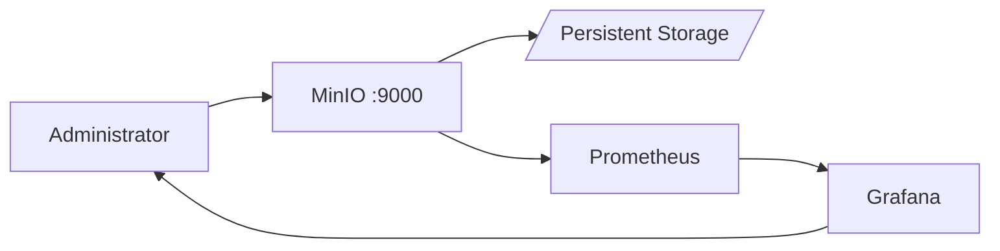

# Architecture — Shared MinIO

## 1. Ringkasan

Shared MinIO adalah object storage S3-compatible single-node berbasis Docker Compose. Prometheus dan Grafana menyediakan observability. Tidak ada Nginx di stack ini, dan tidak ada aplikasi lain yang dihubungkan lewat network bersama.

## 2. Context Diagram



## 3. Port & Network

Semua service berada di Docker network privat `sharedminio-alimaksum`. Hostname `minio` hanya berlaku di dalam stack ini.

| Port host | Service | Catatan |
|---|---|---|
| `MINIO_API_PORT` (default 9000) | S3 API | Host port, bukan network bersama aplikasi |
| `MINIO_CONSOLE_PORT` (default 9001) | Console | Admin / VPN only |
| `GRAFANA_PORT` (default 3030) | Grafana | Monitoring UI |

Port MinIO tidak boleh diekspos ke internet publik tanpa kontrol akses.

## 4. Path

```text
/opt/sharedminio/          deploy path repo
/srv/sharedminio/data/     object MinIO (MINIO_DATA_PATH)
```

## 5. Retention Monitoring

Prometheus retention dibatasi (default 15 hari) agar monitoring tidak menghabiskan disk.
